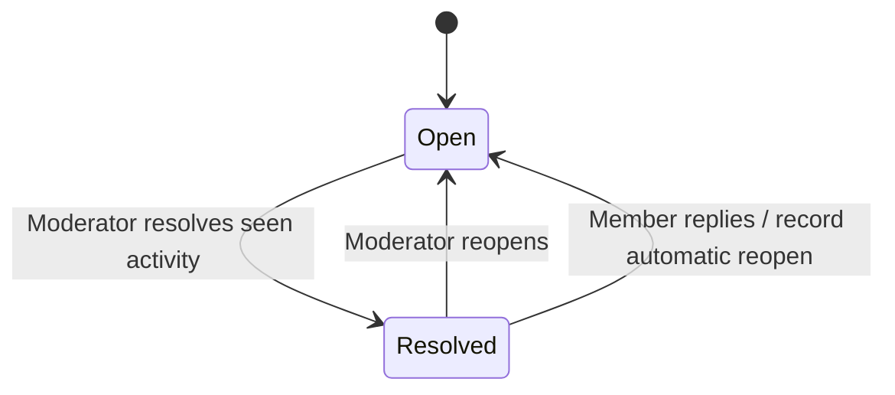

---
ddx:
  id: SD-008
  type: solution-design
  activity: design
  authoring:
    home: repo
  links:
    - id: FEAT-008
      kind: informed_by
    - id: FEAT-004
      kind: informed_by
    - id: FEAT-007
      kind: informed_by
    - id: concourse.architecture
      kind: informed_by
    - id: CONTRACT-003
      kind: informed_by
---

# SD-008 — Maintainer Workspace

**Feature**: FEAT-008. **Artifact**: `solution-designs/SD-008-maintainer-workspace.md`.

## Scope

Design a dedicated application over the existing Concourse backend. The owner
explicitly selected feedback and discussions together, with search, sort, filters
and a simple dashboard. Initial workflows are New/In review/Closed for
feedback and Open/Resolved for discussions. One installation per workspace is a
planning assumption. The native workspace follows CONTRACT-003;
the [clickable prototype](../prototypes/maintainer-workspace.html) uses synthetic
data only. Its local query/review simulation is for interface review, not evidence
of FTS, D1 concurrency or production behavior.

Baseline before FEAT-008: `src/server/feedback.ts` exposes newest-first feedback pages;
`src/server/store.ts` exposes comments by resource/anchor. Neither legacy surface implemented
cross-resource search, counts, triage or thread resolution. `src/server/http.ts`
authorizes feedback reads through exact maintainer emails. Preserve legacy APIs.

## Requirements Mapping

| Requirement | Capability | Component |
|---|---|---|
| MW-01 | Separate whole-result feedback/thread counts and recent activity | Overview and independently authorized summaries |
| MW-02 | Indexed text, combined predicates, stable queue-specific orders | Query application and D1 adapter |
| MW-03 | Bounded detail, original context, replies and continuation | Feedback/discussion queue and detail views |
| MW-04 | Versioned review events, retry receipts, reply-aware resolution | Feedback triage and discussion review services |
| MW-05 | Authorization before every asset, count, record or command | Host identity adapter and capability policy |
| MW-06 | Accessible responsive controls and explicit failure outcomes | Admin client and planned browser corpus |

### NFR Impact on Architecture

Keep content out of static public output and request logs. Bound query/page sizes
server-side; measure query plans, rows read and latency on a synthetic corpus of
10,000 submissions and 10,000 comments before release. These are qualification
fixtures, not traffic forecasts or promised service levels. Use native controls,
named outcomes, visible focus and narrow-screen detail navigation. Cost/traffic
budgets remain operational decisions; no unmeasured performance guarantee follows.

## Solution Approaches

| Approach | Benefit | Cost / limitation | Choice |
|---|---|---|---|
| Extend widgets and filter downloaded rows | Small visible change | Searches only loaded data; embeds the operator app in publications | Reject |
| Dedicated workspace on existing Worker/D1 | Same identity, origin and release; complete server-side queries | Add indexes, review events and protected assets | Select |
| Separate admin service and external search engine | Independent scaling | New credentials, replication and failure modes without measured need | Defer |

The selected UI lives under `/__concourse/admin/`, already within the Access/Worker
route. Check capabilities before shell, assets and API responses. Build the admin
asset manifest into the reviewed Worker bundle; no new public asset origin,
application server or Wrangler asset-binding configuration is needed. The widget
inboxes link to the workspace instead of becoming miniature dashboards.

## Domain Model

| Entity | Authority / identity | Behavior |
|---|---|---|
| Feedback | Immutable submission, site + ID | Body, category, resource/revision, author label |
| Comment | Immutable contribution, site + ID | Original text/context and optional parent |
| Discussion thread | Root comment, site + root ID | Root plus descendants; original root context preserved |
| Review event | Immutable, target + increasing version | Status transition, actor, time and command receipt or reply cause |
| Review head | Derived from events | Feedback status or thread resolution; absent means New/Open version 0 |
| Thread membership | Derived from comment ancestry | Root ID per comment, independent of pagination |
| Search projection | Derived from canonical messages | Full-text matching, never authorization authority |

### Business Rules

- **BR-1** — Trusted host and verified identity determine authority. Feedback
  maintainers and discussion moderators are separate capabilities; neither implies
  the other. Query criteria, cursors and client capabilities never grant access.
- **BR-2** — Feedback triage changes metadata, not original text. New means
  untriaged, not unread; In review means actively considered; Closed means triage
  complete, not proof of a fix. Any state may reopen. No status sends notifications.
- **BR-3** — A discussion is a root and all descendant replies in the same site/
  resource/anchor. Resolution is not a lock: members may reply. A new reply to a
  resolved thread reopens it and records the cause once. Never hide or edit text.
- **BR-4** — A manual command atomically records its receipt/audit and head. Same
  actor/key/payload replays its historical result; changed payload conflicts.
  Discussion resolution also checks the latest contribution ID the reviewer saw.
- **BR-5** — Search and counts apply authorized predicates before pagination.
  Unavailable data is not an empty result. Summary counts are not page totals.
- **BR-6** — Continuation is bounded and query-bound, not a frozen historical view.
  New contributions wait for queue refresh; concurrent review changes may affect
  membership. Item detail always loads current authorized state.
- **BR-7** — One workspace covers one installation. Shared Google identity does
  not authorize another Worker/database. Federation needs a separate design.

## System Decomposition

| Component | Responsibility | Interfaces |
|---|---|---|
| Admin views | Overview, feedback queue/detail, discussion queue/thread | CONTRACT-003 and server capabilities |
| Shared browser transport | Same-origin calls, sign-in/expiry, safe errors | Extract existing browser/api transport; no widget-view coupling |
| Management application | Capability checks, normalized queries and command rules | Host-neutral feedback/discussion repository ports |
| D1 adapter | Fixed SQL/FTS, ancestry projection, keysets, guarded review events | Existing D1 binding, independently tested native profile |
| Worker composition | Verified Access identity, protected assets and wiring | Existing route/issuer/site configuration |
| Future Batten adapter | Verified host identity, routing and repository ports | Same application behavior after independent qualification |

No general query interpreter, runtime schema executor or arbitrary UMF action
endpoint is introduced. D1 and Databricks need not share physical indexes or SQL.
Batten can host the management/backend plugin; the static-publication plugin remains
separate. Interface shape alone does not qualify Apps identity or storage behavior.

### Experience Traceability

| Task | View | Interaction |
|---|---|---|
| Understand attention needed | Overview | Separate Feedback and Discussions sections; counts open the matching queue |
| Find a report | Feedback | Text, type/status/page/received-date filters; newest/oldest/type order |
| Find a conversation | Discussions | Text across roots/replies, status/page/activity-date filters; recent activity/newest/oldest order |
| Review original context | Detail/thread | Resource, anchor, revision, original text, reply relationship and trusted source link |
| Record progress | Detail/thread | Triage or resolve/reopen; inspect history and reconcile conflicts |
| Return to work | Both queues | Preserve each queue's criteria/selection/scroll, scoped to principal |

Desktop uses a list/detail split; narrow screens use full detail with Back to
results. Keep independent filters per queue: feedback type and discussion activity
are not the same concepts. The overview has a period selector: feedback counts
refer to received time, discussion counts to last activity, with explicit labels.
Each card carries the corresponding predicates into its queue. No global total
combines messages, threads and feedback. Unauthorized sections are omitted, not
shown as zero. One section's failure does not erase the other section's counts.

Use explicit search/Apply, refresh and bounded continuation. Keep private queries,
cursors and selected IDs out of navigation URLs; restore them only from session
storage scoped to principal/site. No boards, bulk automation or live push is needed.

### Query and projection behavior

Use D1's supported FTS5 for unranked text matching. Feedback indexes body, quote,
resource and author label; comments use a separate projection with the same fields.
A matching root or any matching reply includes a discussion once. Canonical tables
still determine scope and visibility. Users cannot submit SQL, FTS operators or
field expressions. Exact normalization and query shapes belong to CONTRACT-003.

Feedback sorts use immutable received time/category with ID ties. Discussions add
last activity, computed only over contributions beneath the query's maximum comment
ID. That watermark keeps new replies from moving a thread midway through paging.
Review status remains current, so queue membership is not a historical snapshot.
Counts cover the complete matching set at one read; separate summary/list requests
may observe different writes. Do not sort by relevance or mutable review time yet.

Build thread membership from parent links, not the loaded comment page. Existing
parents precede children and remain immutable. Preserve root context and per-reply
revision. A thread detail returns the root plus bounded replies with parent IDs.
Do not invent a current-publication-revision filter or guess URLs from Markdown
paths: neither a universal route map nor current-revision registry exists today.
Use a trusted publication-link adapter, otherwise display/copy resource identity.

### Review writes and reply races

Manual feedback/thread commands insert one guarded event using trusted site,
target ID and expected head version. Thread commands additionally require the
current maximum contribution ID to match the one observed by the moderator. An
AFTER INSERT trigger updates the projected head in the same native statement.
The immutable event doubles as the command receipt. Resolve a previous same-key
receipt before returning a conflict; a zero-row guarded insert is never assumed
successful. Refetch current detail after replay: the receipt can precede later events.

Comment insertion maintains thread membership and search atomically. If a new reply
finds a resolved head, it inserts one reply-caused reopen event and projects Open.
Legacy comment replay does not insert another comment, so it cannot reopen twice.
If resolve wins before a reply, the reply reopens; if the reply wins first, the
moderator's stale contribution guard rejects resolution. Test both interleavings.
Automatic events identify the actual contribution/author; do not pretend a moderator
performed them. Resolve/reopen does not grant the moderator feedback access.

Additive comment read fields expose thread IDs and Open/Resolved badges to authorized
readers, without exposing moderation history. Old clients may ignore them. A submitted
reply reloads thread state. Widget semantics must agree with the workspace.

## Technology Rationale

Reuse native browser components, Worker and D1. Built-in FTS5 avoids another search
service. New native query and review interfaces extend existing contracts rather
than replacing submission/reply behavior. Explicit moderator addresses require a
reviewed installation configuration change; existing feedback maintainers do not
silently acquire moderation rights. No identity group administration is introduced.

## Traceability

| Acceptance corpus | Planned proof |
|---|---|
| Query correctness | Full-result searches, combined filters, all orders, ties, Unicode, empty/no-match; a reply-only match returns one root |
| Paging/activity | Watermark-bound activity order, new roots/replies, status changes, query-fingerprint mismatch and bounded detail/history |
| Permissions | Separate maintainer/moderator/both/member/anonymous/expired/foreign-site cases for shell/assets/counts/search/detail/commands |
| Writes | Concurrent version conflict, unseen-reply guard, both resolve/reply races, replay after later events, changed payload and trigger rollback on actual D1 |
| Migration | Existing feedback New, existing threads Open; no fabricated history; correct ancestry/backfill; unchanged legacy submission/replay |
| UX | Overview drill-down, both queues, keyboard/detail/back, date labels, capability omissions, expiry/conflicts and unknown outcomes on mobile/desktop |
| Recovery | Canonical export to isolated database, head/membership/index rebuild and result parity; no reader-data export during design |

### Gaps

Native management interfaces implement these rules. Local production Worker/D1
verification covers FTS, guarded review writes, reply races, trigger rollback and
canonical restore/rebuild. Remote D1 migration/export and live provider acceptance
remain deployment qualification; local verification does not establish them.
Cross-installation aggregation, comment editing/hiding and external automation stay
outside this design. Production operations need their own authorization.

## Concern Alignment

Apply managed identity, native DOM, relational modeling, resource identity,
serverless deployment, accessibility and private diagnostics. Extend the existing
`bun run check:boundaries` according to Architecture's proposed module map. Record
only operation, outcome, timings and bounded work counts; never record message text,
search text, actor email, JWT, cursor or selected text. The product dashboard is
review workflow, not service monitoring. No OTel receiver integration is implied.

## Constraints & Assumptions

Feedback and discussions together is owner-selected. Proposed defaults are one
installation, three feedback states, two discussion states, separate explicit roles,
and reopening on reply. They are implemented defaults; production rollout remains separately authorized.
No additional search service, secret, identity group or frontend framework is selected.

## Risks

| Risk | Mitigation |
|---|---|
| FTS dump cannot be restored into D1 directly | Prove canonical-table-only export/import and rebuild before migration |
| Projection trigger failure blocks reader writes | Qualify rollback and an approved trigger/index recovery path; retain retry identity |
| Resolution hides unseen activity | Contribution-ID guard and exactly-once reopen event for new replies |
| Private feedback leaks through discussion view | Separate capability, query, summary and error boundaries |
| Counts/paging imply stronger consistency | Explicit observed times and watermark/refresh semantics |

## Schema Basis

Inspected UMF core 0.10.0 (`spec/metamodel/umf.yaml`), CONTRACT-071 query catalog,
its `d1-read.schema.json`, and CONTRACT-900 action obligations at UMF source revision
`0bb8b8c869ca12f0a39cbb87520b7f9fab1b3d97`. Reuse identity, parameter binding and
query/order-bound continuation concepts. That generated query profile is not
integrated into Concourse's TypeScript Worker. No inspected source supplies the
feedback/thread review model or a qualified mutation adapter for this deployment.
Keep an explicit native contract without claiming UMF API/action qualification.

## Source evidence

Reviewed 2026-11-23: Cloudflare documents [FTS5 support](https://developers.cloudflare.com/d1/sql-api/sql-statements/)
and [native transaction behavior](https://developers.cloudflare.com/d1/worker-api/d1-database/).
The [export API](https://developers.cloudflare.com/api/resources/d1/subresources/database/methods/export/)
supports table selection; its SQLite-only virtual-table dump cannot be imported
back into D1. These vendor features are not deployed Concourse acceptance.
